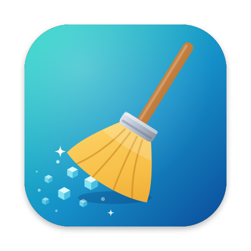
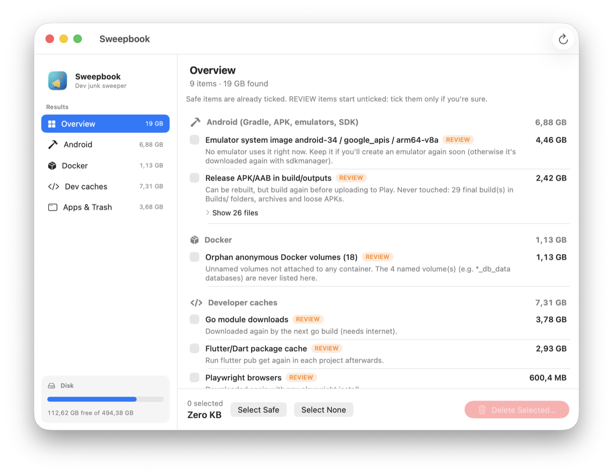

<p align="center">
  
</p>

<h1 align="center">Sweepbook</h1>

<p align="center">Sweep the dev junk off your Mac.</p>

<p align="center">
  <a href="https://github.com/debycandra/sweepbook/releases/latest">Download</a> ·
  <a href="#what-it-cleans">What it cleans</a> ·
  <a href="#build-from-source">Build from source</a>
</p>

---

I made Sweepbook to make sweeping my MacBook easier, so the SSD (and RAM) get some room again.

If you build Android, Flutter or Docker stuff on a Mac, you know how it goes. Gradle caches,
debug APKs, old emulators, an NDK you don't use anymore, Docker build cache. It piles up quietly
until macOS says your disk is almost full. I used to clean all of that by hand in the terminal.
The first time I did it properly I went from 33 GB to 110 GB free.

Sweepbook turns those steps into one window: **Scan**, check the list, **Delete**.



## How it works

1. Click **Scan** (⌘R). Nothing is deleted. It just measures, and you can watch each step tick off.
2. Look through the list. The sidebar splits it into Android, Docker, dev caches and apps, with
   sizes. Things that are always safe to remove are already ticked. Things you should think about
   first are marked **REVIEW** and start unticked.
3. Click **Delete Selected** (⌘⌫). You get one last look at exactly what goes, then a progress
   screen, then how much space you got back.

A few rules it sticks to:

- **Safe** means the tool rebuilds or re-downloads it on its own (caches, build output).
- **REVIEW** means it's regenerable, but you might lose time or state (an emulator with apps
  installed, a release build you haven't uploaded yet, downloaded packages).
- **Never listed:** release builds in `Builds/` folders, archived releases, loose APKs, named Docker
  volumes (your databases), and anything in Documents, Desktop or Photos.
- If an app is open (Chrome, VS Code, an emulator), its items are blocked until you quit it.
- It refuses to delete anything outside your home folder or the Android SDK, whatever the list says.
- Every deletion is logged to `~/Library/Logs/Sweepbook.log`.

## What it cleans

| Area | Safe | Review |
|---|---|---|
| Android | Gradle caches, debug/profile APKs, build intermediates | Whole emulators (AVDs), AVD snapshots, unused NDKs, unused system images, release APK/AAB in `build/outputs` |
| Docker | Build cache, unused images | Orphan anonymous volumes |
| Dev caches | Go build cache, npm, Yarn, pip, uv, Homebrew downloads, CocoaPods, node-gyp, Dart analysis, Xcode DerivedData | Go modules, pub cache, iOS DeviceSupport, Playwright browsers, Kotlin/Native |
| Apps | VS Code update leftovers and downloaded extension packages | VS Code caches, Chrome and Edge caches, Trash |

Docker items only show up while Docker Desktop is running. If it's off, Sweepbook gives you a button to
start it and scan again. Heads up: starting Docker also starts any container set to `restart: always`.

## Install

1. Download `Sweepbook-x.y.z.zip` from the [latest release](https://github.com/debycandra/sweepbook/releases/latest).
2. Unzip it and drag **Sweepbook.app** into Applications.
3. The app isn't notarized by Apple (yet), so the first time you open it macOS will block it.
   Open **System Settings → Privacy & Security**, scroll down and click **Open Anyway**.
   Or, from the terminal:

   ```bash
   xattr -dr com.apple.quarantine /Applications/Sweepbook.app
   ```

Works on macOS 13 or newer, Apple Silicon and Intel.

To check the download, compare it with the `.sha256` file in the release:

```bash
shasum -a 256 -c Sweepbook-x.y.z.zip.sha256
```

## Build from source

You only need the Xcode Command Line Tools (`xcode-select --install`), not the full Xcode.

```bash
git clone https://github.com/debycandra/sweepbook.git
cd sweepbook
./build.sh --install   # builds build/Sweepbook.app and copies it to ~/Applications
./test.sh              # runs the cleanup rules against a fake home folder
```

You can also scan from the terminal. This is read-only:

```bash
~/Applications/Sweepbook.app/Contents/MacOS/Sweepbook --scan
```

The cleanup rules live in [`Sources/Engine.swift`](Sources/Engine.swift). Each item is one small
function, so adding a new cache is usually a few lines.

## Limitations

- Deletes are permanent. There's no undo yet, so read the REVIEW items before you tick them.
- Trash only shows up if Sweepbook has Full Disk Access (System Settings → Privacy & Security).
- The Android SDK is looked for in `$ANDROID_HOME`, the Homebrew `android-commandlinetools`
  folder and `~/Library/Android/sdk`.
- Freeing RAM (idle Gradle daemons, VMs) isn't in yet. It only stops Gradle daemons when you
  clean the Gradle cache.

## License

[MIT](LICENSE)
